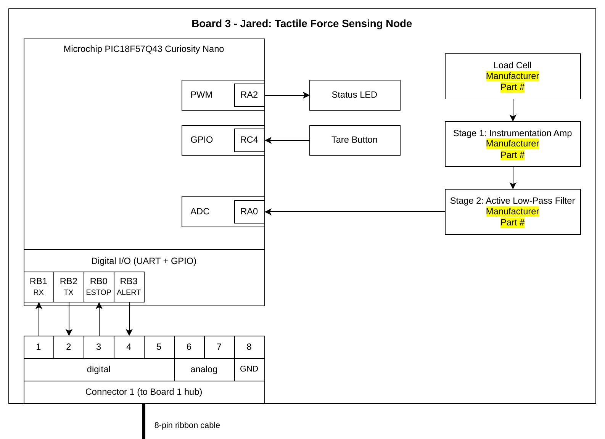

## Overview
Sensing: My board will utilize an FSR sensor for force data

Power: The board will be powered via a barrel jack from a battery or a wall outlet adapter into a voltage regulator.

Connector to Bus Node: I will utilize an 8-pin connector to the Hub Board for digital and analog.

## Block Diagram 

