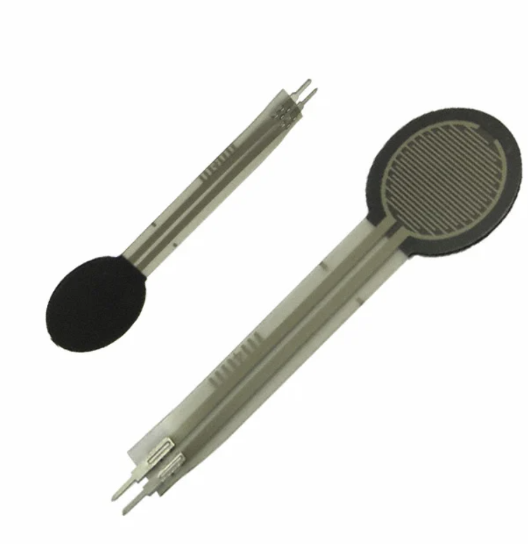
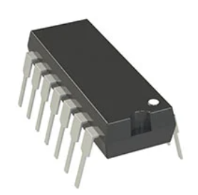
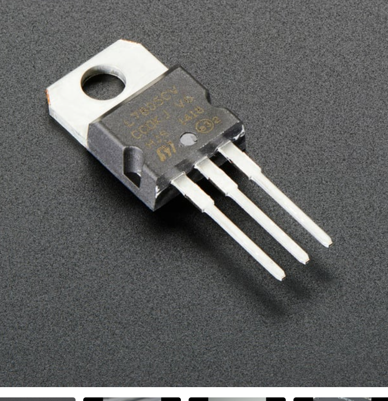

## Component Selection

**Force Sensor (Force Sensing Subsystem)**

| **Solution** | **Pros** | **Cons** |
| --- | --- | --- |
|  Interlink FSR 402 round force-sensing resistor $7.12/each [FSR 402 on DigiKey](https://www.digikey.com/en/products/result?keywords=30-81794) | \* Force range of about 0.2–20 N covers both an egg and a baseball \* Low turn-on force detects first contact with fragile objects \* Very thin, fits under a pad on the gripper finger \* Full datasheet with force vs. resistance curves | \* Nonlinear output, needs calibration with known weights \* Reading drifts slightly under a constant load \* Small round sensing area, force must be centered on it |

**Rationale:** The FSR 402's range (about 0.2–20 N) covers our full target of 0.5–15 N, from light contact with an egg to a firm grip on a baseball. It is thin enough to mount on the gripper finger and has a full manufacturer datasheet for designing and calibrating the voltage divider circuit.

**Op-Amp (Signal Conditioning Subsystem)**

| **Solution** | **Pros** | **Cons** |
| --- | --- | --- |
|  Microchip MCP6004-I/P quad op-amp $0.59/each [MCP6004 on DigiKey](https://www.digikey.com/en/products/detail/microchip-technology/MCP6004-I-P/MCP6004-I-P-ND/523060) | \* Rail-to-rail input and output, uses the full 0–5 V ADC range \* Runs directly off our single 5 V rail \* Four op-amps in one chip cover the gain stage and the low-pass filter \* Through-hole package, already in our kit | \* Input offset up to about 4.5 mV (removed by the tare button) \* 14-pin package takes more board space \* Unused op-amps must be tied off |

**Rationale:** The MCP6004 runs on our single 5 V rail, and its rail-to-rail output lets the signal use almost the full 0–5 V ADC range. One chip covers both analog stages, the gain stage (×1.5) and the Sallen-Key low-pass filter, and the two unused op-amps are tied off with pull-down resistors.

**5V Voltage Regulator (Power Subsystem)**

| **Solution** | **Pros** | **Cons** |
| --- | --- | --- |
|  LM7805 5 V 1.5 A linear regulator, TO-220 $0.75/each [LM7805 on Adafruit](https://www.adafruit.com/product/2164) | \* Accepts 7–35 V, covers the required 9–12 V input \* 1.5 A output, far more than our board needs \* Built-in current limiting and overheat protection \* Through-hole and well documented | \* Needs at least 7 V input to stay regulated \* Turns extra input voltage into heat \* Uses about 6 mA just to stay on |

**Rationale:** The LM7805 meets the course requirements for a through-hole linear regulator that accepts 9–12 V and outputs 5 V. With our 9 V wall adapter and the 1N4007 reverse-polarity diode, the regulator sees about 8.3 V, above its 7 V minimum, and gives off only about 0.2 W of heat, so no heatsink is needed.
