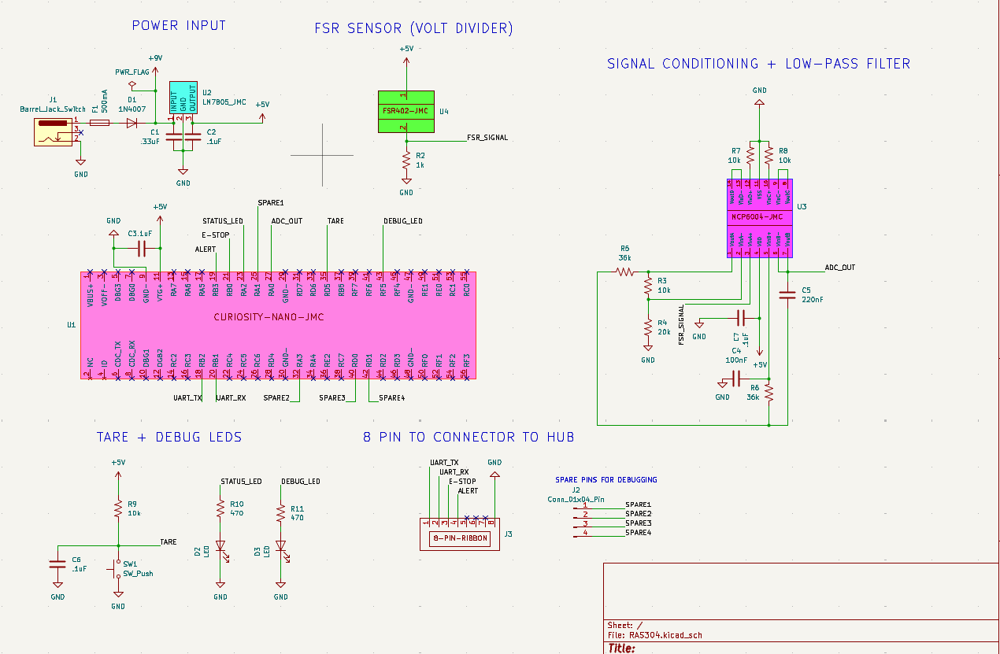

## Overview

The schematic design and my board is responsible for force data utilizing the FSR-402 pressure sensor. The FSR sensor I chose is a variable resistor that increases conductivity upon pressure exertion. I am utilizing a voltage divider to output an analog voltage which rises as the sensor is pressed more. There is a second-stage op-amp circuit (MCP6004) for signal conditioning and implementation of a low-pass filter. After the op-amp stage the signal goes to ADC via my PIC's RA0 pin. I also have a tare button to zero force reading via our firmware, LEDs and extra pins for debugging, and the 8-pin connector for Hub Board.

{style width:"350" height:"300;"}

## Resources

The schematic as a PDF download is available [*here*](Board-3-Force-Sensing-Node.pdf), and the Zip folder of the project [*here*](my-board-3.zip).
